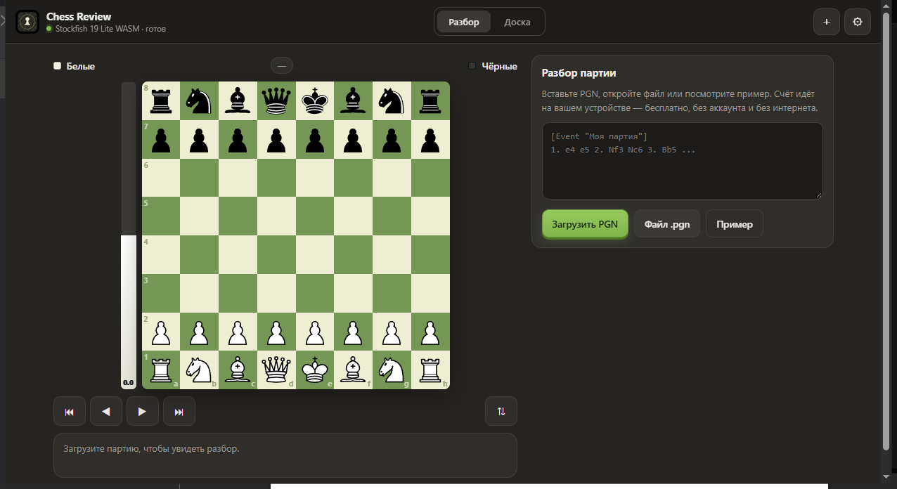

# Chess Review

Бесплатный разбор шахматных партий в стиле chess.com: Stockfish 19 работает **прямо на устройстве**, без аккаунта, подписки и интернета.

Одно и то же веб-приложение запускается тремя способами:

| Где | Как |
| --- | --- |
| Браузер / телефон | обычный сайт (PWA, работает офлайн) |
| Windows | `ChessReview.exe` — самодостаточный файл, WebView2 |
| Android | `ChessReview.apk` — WebView + локальный HTTP-сервер |



## Что умеет

- **Разбор партии целиком**: оценка каждого хода, классификация (лучший, отличный, хороший, неточность, ошибка, грубая ошибка, зевок, блестящий), точность в процентах для обоих игроков.
- **График оценки** по ходам — клик по точке переносит на позицию.
- **Стрелки лучших ходов** на доске, подсказка дебюта по книге (3 835 вариантов).
- **Импорт PGN**: вставка текста, файл, несколько партий в одном файле (с выбором), стартовая позиция из FEN.
- **Свободная доска**: играйте ходы и получайте 3 линии анализа от Stockfish.
- **Офлайн**: движок, книга дебютов и правила лежат внутри приложения.
- **Кэш разборов** в локальном хранилище: повторный разбор той же партии на той же глубине мгновенный.

## Движок

Используется [Stockfish 19](https://stockfishchess.org/) в сборке `lite-single` (WebAssembly, ~1.8 МБ) — однопоточный вариант без `SharedArrayBuffer`, поэтому не требует cross-origin isolation и предсказуемо работает в мобильном WebView.

Глубина по умолчанию — 12 полуходов (настраивается в «Настройках»). На среднем телефоне разбор партии из ~40 ходов занимает несколько секунд.

## Запуск из исходников

Нужен только Python 3 (для локального сервера):

```bash
cd chess-review
python serve.py          # http://127.0.0.1:8090
```

Или `start.bat` в Windows.

## Сборка

### Windows (EXE)

Нужен .NET 8 SDK. Скрипт упаковывает веб-часть в `web.zip`, встраивает её в сборку и публикует self-contained single-file EXE:

```powershell
powershell -ExecutionPolicy Bypass -File tools\build_desktop.ps1
```

Результат: `dist/ChessReview-win64/ChessReview.exe` (~65 МБ, .NET внутри). Требуется установленный **Microsoft Edge WebView2 Runtime** — в Windows 10/11 он уже есть.

### Android (APK)

Нужны JDK 17 и Android SDK (build-tools 34.0.0, platform android-34). Gradle не используется — сборка идёт напрямую через `aapt2`, `javac`, `d8`, `zipalign`, `apksigner`:

```powershell
powershell -ExecutionPolicy Bypass -File tools\build_android.ps1
```

Результат: `dist/ChessReview-android.apk` (~1.4 МБ, minSdk 24). Подписан debug-ключом — для установки на телефон этого достаточно, для Google Play нужен собственный ключ.

Ожидаемое расположение инструментов:

```
buildtools/
  jdk/<jdk-17>/
  android-sdk/
    build-tools/34.0.0/
    platforms/android-34/
```

### Данные (книга дебютов, спрайты фигур, иконки)

```bash
python tools/build_data.py
```

Берёт `data/a.tsv … e.tsv` (lichess `chess-openings`), собирает `data/openings.json`, генерирует `css/pieces.css` и PNG-иконки.

## Устройство

```
index.html          разметка
css/                стили, спрайты фигур (data-URI SVG)
js/app.js           интерфейс, PGN, оркестрация разбора, свободная доска
js/engine.js        обёртка над UCI (очередь, прерывание поиска)
js/review.js        нормализация оценки, классификация ходов, точность
js/board.js         отрисовка доски, drag & drop, стрелки, бейджи
js/chart.js         график оценки (canvas)
js/book.js          поиск дебюта по книге
vendor/chess.js     правила и PGN (BSD-2-Clause)
engine/             Stockfish 19 lite-single (WASM)
data/openings.json  книга дебютов (trie по SAN)
desktop/            хост на WinForms + WebView2
android/            Activity + локальный HTTP-сервер на assets
tools/              скрипты сборки
```

В упакованных версиях service worker отключён (файлы и так локальные), в браузере — включён для офлайн-работы.

## Лицензия и благодарности

Проект распространяется по лицензии **GPL-3.0-or-later** — см. [LICENSE](LICENSE).

- **Stockfish 19** — GPL-3.0, © Stockfish developers, <https://stockfishchess.org/>. WASM-сборка `lite-single` из официального репозитория.
- **chess.js** — BSD-2-Clause, © Jeff Hlywa.
- **Фигуры Cburnett** — CC BY-SA 3.0, © Colin M.L. Burnett.
- **Книга дебютов** — данные [lichess-org/chess-openings](https://github.com/lichess-org/chess-openings), CC0.
